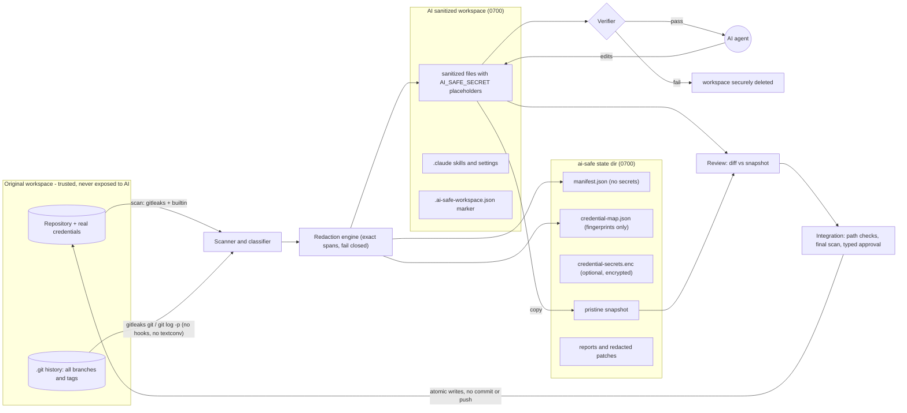

# ai-safe

**Keep real credentials and Git history away from AI coding agents.**

`ai-safe` gives an AI coding agent (Claude Code, Cursor, Copilot, …) a sanitized, verified copy of your
repository. The agent works in that copy and never sees real credentials or the original Git history. You
review what it changed, and you apply the reviewed changes to your real repository yourself, through a
patch-based integration step that keeps your credentials where they are.

```
Developer repo → discovery → classification → sanitization → AI workspace → AI development
              → change extraction → review → controlled integration → final verification
```

> **Honesty first.** `ai-safe` reduces risk. It does not guarantee that every secret is found.
> Pattern-based detection (Gitleaks plus the built-in rules) cannot recognise every credential, and
> Claude Code skills and settings are guidance, not a security boundary. Real isolation comes from
> running the agent as a separate OS user or in a container that mounts **only** the workspace.
> See [Security limitations](#security-limitations) and [SECURITY.md](SECURITY.md).
>
> Penerangan ringkas dalam Bahasa Melayu: [docs/HOW_IT_WORKS_BM.md](docs/HOW_IT_WORKS_BM.md).

---

## Contents

1. [Quick Start: ask your AI to install](#quick-start-ask-your-ai-to-install)
2. [What ai-safe does](#what-ai-safe-does)
3. [Threat model](#threat-model)
4. [Architecture](#architecture)
5. [Installation](#installation)
6. [CLI usage](#cli-usage)
7. [Claude Code integration](#claude-code-integration)
8. [Configuration](#configuration)
9. [Sanitization process](#sanitization-process)
10. [Git history handling](#git-history-handling)
11. [Security limitations](#security-limitations)
12. [Recovery and cleanup](#recovery-and-cleanup)
13. [Example workflow](#example-workflow)
14. [Development and tests](#development-and-tests)

---

## Quick Start: ask your AI to install

Clone this repository, open an AI coding agent in it, and give it this prompt:

> Install ai-safe for me (ask me global or local). If this project is not a Git repository, initialise Git
> first. Add `.ai-safe/` and `.claude/settings.local*.json` to .gitignore. Ask me before changing
> scan_ignored.

The agent follows [AGENTS.md](AGENTS.md) and asks before every download. Then run `ai-safe start` and
`ai-safe open` yourself in a normal terminal.

Those two commands are yours, not the agent's: `start` reads your real repository, and `open` starts the AI
session on the verified workspace. Inside the workspace the AI works freely. When you want the latest
state of your repository again, run `ai-safe resync` (after `ai-safe integrate`, or with `--discard`).
After every `ai-safe integrate`, run `ai-safe resync` before the AI continues working, so the next review
compares against your updated repository.

---

## What ai-safe does

| Step | Command | Result |
|---|---|---|
| Discover | `ai-safe scan` | Secrets in tracked, untracked and ignored files, staged and unstaged changes, every commit on every branch and tag, and commit messages. The report shows locations, categories and fingerprints, never values. |
| Sanitize | `ai-safe sanitize` | A private (0700) workspace outside the repository. Credentials become `${AI_SAFE_SECRET_<NAME>}` placeholders. `.env` files, keys and credential stores are excluded. No `.git`. |
| Verify | `ai-safe verify` | Full re-scan of the workspace: secrets, private keys, symlinks, Git metadata, credential files, binaries, hard links, and known original values matched by keyed fingerprint. Exits non-zero on any problem. |
| Start | `ai-safe start` | Scan, sanitize and verify in one step, then print a security summary and launch instructions. If verification fails, the workspace is deleted (fail closed). |
| Open | `ai-safe open` | Menu to open the verified workspace in an AI agent CLI, VSCode or a Docker container, or to print the commands. Launches only on your menu choice and only with `security.allow_ai_launch: true`. |
| Resync | `ai-safe resync` | Rebuild the workspace from the current repository in place (same path), verified in a staging directory before anything reaches the live workspace. |
| Review | `ai-safe review` | Diff of the workspace against a pristine snapshot kept outside it. Flags hardcoded credentials, placeholder misuse, sensitive-file and `.gitignore` changes, symlinks and hard links, files in ignored paths, hidden control characters, and conflicts. |
| Integrate | `ai-safe integrate` | Applies the reviewed changes to the original repository after path validation, a final scan and your typed approval. Credentials are preserved. Nothing is committed or pushed. |
| Cleanup | `ai-safe cleanup` | Securely deletes workspaces, snapshots and mappings. |

Credential categories: `API_KEY`, `ACCESS_TOKEN`, `PASSWORD`, `DATABASE_CREDENTIAL`, `PRIVATE_KEY`,
`SSH_KEY`, `CLOUD_CREDENTIAL`, `JWT_SECRET`, `GENERIC_SECRET`.

---

## Threat model

Full version: [SECURITY.md](SECURITY.md).

**Assets:** credential values in the working tree and in Git history; the original `.git` directory; the
credential mapping; the integrity of the original repository.

**Adversary:** an AI agent that may be careless, prompt-injected (for example by a malicious file or
dependency) or actively trying to exfiltrate data. It fully controls the contents of its workspace: file
names, contents, symlinks, hard links and timing.

**Trust boundaries:**

| Trusted | Untrusted |
|---|---|
| Original repository and its `.git` | Everything inside the AI workspace |
| ai-safe state directory (`~/.local/state/ai-safe`) | Output of the AI (files and commands) |
| The developer at a normal terminal | Any process with the `CLAUDECODE`, `AI_SAFE_AGENT`, … environment |

**What ai-safe enforces:**

- No credential value it detected is written to the workspace, terminal, reports, manifest or mapping.
- No original `.git` data in the workspace, and the workspace does not reveal the original repository path.
- The review baseline (the snapshot) and the mapping live outside the workspace.
- Integration never writes outside the repository, never writes through symlinks, never touches excluded
  or credential files, never restores credentials into AI-written lines, and never commits or pushes.
- Scanning never executes Git hooks, textconv drivers, external diff tools or anything from the workspace.

**What the environment must enforce:** that the AI process cannot read the original repository or the
state directory. ai-safe **cannot** enforce this when the agent runs as the same OS user with full disk
access. Use a container or a separate user.

---

## Architecture



### Modules (`src/ai_safe/`)

| Module | Responsibility |
|---|---|
| `cli.py` | Typer commands, exit codes, redacted error handling |
| `config.py` | Pydantic models for `ai-safe.yaml`. Unknown keys and unsafe values are rejected. |
| `models.py` | `Finding`, `Issue`, `Category`, `Location`, `Severity`. Secrets are kept out of `repr` and serialization. |
| `security.py` | Private temp dirs and files, path validation, `O_NOFOLLOW` reads, redactor, HMAC fingerprints, hardened subprocess and Git configuration, secure deletion |
| `classifier.py` | Credential categorization, sensitive-path matching, file kinds, key-name analysis |
| `detectors.py` | Built-in detection engine: provider tokens, private keys, key/value assignments, YAML blocks, custom rules |
| `php_calls.py` | Credentials passed as string literals to PHP calls: databases (`new PDO`, `mysqli_connect`, `pg_connect`, `$this->db->connect(...)`, …), FTP, LDAP, IMAP/POP3, SSH, Redis, AMQP, Memcached, AWS SDK (S3/MinIO), `CURLOPT_USERPWD` |
| `gitleaks.py` | Hardened Gitleaks wrapper: forced config, ignore files and inline allows disabled, private shredded report |
| `git_history.py` | Read-only Git access: file lists, staged and unstaged diffs, full-history added lines, commit messages, sanitized summaries |
| `scanner.py` | Runs both engines across all locations. Deduplicates, classifies and fingerprints findings. |
| `redaction.py` | Redaction engine and deterministic placeholder registry |
| `sanitizer.py` | Builds the workspace, writes the manifest, runs the final known-value sweep |
| `workspace.py` | Sessions, state layout, marker, Claude Code integration, snapshot, cleanup |
| `credential_map.py` | Mapping storage: metadata only, plus optional encrypted values |
| `verifier.py` | Workspace verification, including the keyed-fingerprint known-value check |
| `patch_manager.py` | Change collection, hunks, mapping hunks from the snapshot onto the original |
| `review.py` | AI change review and integration plan |
| `integration.py` | Controlled, patch-based application to the original repository |
| `reporting.py` | Rich terminal output through a redacting stream; JSON reports |

---

## Installation

Requirements: Python 3.11+ (3.12+ recommended), Git, and [Gitleaks](https://github.com/gitleaks/gitleaks) 8.19 or later.

```bash
git clone <this repo> ai-safe && cd ai-safe
./install.sh --global                      # per-user: ~/.local/bin/ai-safe + ~/.claude/skills
./install.sh --local /path/to/your/project # or: inside one project (.ai-safe/ + .claude/skills)
```

`install.sh` asks before downloading anything: Python packages from PyPI, and the official Gitleaks
release, whose SHA-256 is verified. It uses no sudo and adds `.ai-safe/` to the project's `.gitignore`.
`--uninstall` reverses it. AI agents should follow [AGENTS.md](AGENTS.md).

Manual installation (development):

```bash
python3 -m venv .venv && . .venv/bin/activate
pip install -e ".[dev]"

# gitleaks: install from your package manager or the official release, then
gitleaks version            # or set scanner.gitleaks_path / $AI_SAFE_GITLEAKS
ai-safe version
```

Without Gitleaks, `ai-safe` refuses to run (exit code 3) unless you explicitly set `scanner.engine: builtin`.

---

## CLI usage

```bash
# Install
pip install -e .

# Scan
ai-safe scan

# Sanitize
ai-safe sanitize

# Verify
ai-safe verify

# Start AI-safe workflow
ai-safe start

# Open the verified workspace (AI agent CLI, VSCode, Docker, or print the commands)
ai-safe open

# Rebuild the workspace from the current repository, same path
ai-safe resync

# Review AI changes
ai-safe review

# Integrate approved changes
ai-safe integrate
```

| Command | Main options | Exit codes |
|---|---|---|
| `ai-safe scan [PATH]` | `--no-history`, `-o report.json`, `--gitleaks-report gl.json`, `-c ai-safe.yaml` | 0 clean · 1 findings |
| `ai-safe sanitize [PATH]` | `--history-summary` | 0 · 3 error |
| `ai-safe verify` | `--session ID`, `--workspace DIR`, `-o report.json` | 0 pass · 1 fail |
| `ai-safe start [PATH]` | `--history-summary`, `--launch` (needs `security.allow_ai_launch`) | 0 ready · 1 verification failed |
| `ai-safe open` | `--session ID`, `-c ai-safe.yaml` | 0 launched or printed · 1 workspace unverified or missing · 2 no TTY, no valid choice, or Docker image not set · 3 refused inside an AI agent session, or the launch failed |
| `ai-safe resync` | `--session ID`, `-c ai-safe.yaml`, `--discard` (also asks you to type `discard`) | 0 resynced · 1 pending changes, verification failed or not confirmed · 3 refused inside an AI agent session |
| `ai-safe review` | `--session ID`, `-o report.json` | 0 pass · 1 blocking issues |
| `ai-safe integrate` | `--dry-run`, `--exclude PATH` (repeatable), `--session ID` | 0 applied/dry run · 1 refused |
| `ai-safe cleanup` | `--session ID`, `--all`, `--yes` | 0 |
| `ai-safe sessions` | | 0 |
| `ai-safe mapping show` | `--env-template` | 0 |
| `ai-safe history-summary [PATH]` | `-o FILE`, `--max-commits N` | 0 |
| `ai-safe skills install [DIR]` | | 0 |
| `ai-safe init [PATH]` | `--force` | 0 |

Exit code `2` means invalid configuration or usage. Exit code `3` means an operational error, which always
fails closed.

**`ai-safe open`** never launches anything on its own. With `security.allow_ai_launch: false` (the
default) it prints the commands and exits. Otherwise it shows a menu: (1) the AI agent CLI
(`security.launch_command`), (2) VSCode (`code -n <workspace>`), (3) Docker (`security.docker_image`, which
mounts only the workspace; without an image or without `docker` on PATH it prints an example command),
(4) print the commands only. The launched process gets only the `security.launch_env_allowlist` variables
plus `AI_SAFE_AGENT=1`. VSCode alone also gets the display and session variables it needs on Linux and WSL
when they are set (`DISPLAY`, `WAYLAND_DISPLAY`, `XDG_RUNTIME_DIR`, `DBUS_SESSION_BUS_ADDRESS`,
`WSL_DISTRO_NAME`, `WSL_INTEROP`, `WSLENV`); the agent CLI and Docker never do. It refuses inside an AI agent session, on a workspace that has not passed
verification (or whose last verification failed), and while a resync is unfinished.

**`ai-safe resync`** builds and verifies a fresh workspace in a staging directory next to the current one,
then swaps the session state and the workspace contents in place. The workspace keeps its path, so an
editor window stays valid, but close any AI session in it first. A failure before the swap (scan,
sanitization, verification) leaves the old workspace and the session state untouched. A failure or
interrupt during the swap rolls both back; while the swap runs the session is marked `resyncing` with no
verified hash, so if the process dies or a rollback cannot complete, `open`, `integrate` and `verify`
refuse the session until you run `ai-safe resync` again. If a rollback cannot complete, the old contents
are kept (never deleted) and the error names the directory. It runs without `--discard` only when the workspace has no changes since the
snapshot, or is exactly what you last integrated in full. A full integration means every AI change
was applied: a change that review left out (a binary or mode-only change, Git metadata, `--exclude`)
still counts as pending. Changes to tool metadata that is never integrated (ai-safe's generated files and
skills, `.claude/settings*.json`, other `.claude/` paths) do not count. Otherwise integrate first, or pass
`--discard` and type `discard` to throw the changes away. After `ai-safe integrate`, run `ai-safe resync`
before the AI continues working. It refuses inside an AI agent session.

`verify`, `review` and `mapping` find their session automatically, either from the workspace marker (when
run inside a workspace) or from the latest session for the current repository.

**Gitleaks JSON reports:** `ai-safe scan --gitleaks-report existing.json` merges an existing
`gitleaks ... --report-format json` report. ai-safe's own `-o` report has the same structure without
secret values.

---

## Claude Code integration

`ai-safe start` writes the following into the workspace:

- `.claude/skills/ai-safe/SKILL.md`: the operating rules. Confirm the workspace marker; never request,
  guess or recover credentials; never read parent directories or anything outside the workspace; use
  environment variables; never hardcode credentials; never touch `.env`; run `ai-safe verify` and
  `ai-safe review` after implementing; report missing configuration as a placeholder requirement.
- `.claude/skills/ai-safe-scan`, `-sanitize`, `-review`, `-integrate`, `-security-audit`: reusable skills.
  Each documents purpose, execution boundaries, expected inputs, outputs and failure conditions.
- `.claude/settings.json`: `permissions.deny` rules for `.env*`, the marker, the ai-safe state directory,
  `git push`, `ai-safe integrate` and `ai-safe cleanup`, merged with the allowlisted parts of your team's
  `.claude/settings.json` (see [Configuration](#configuration)). The original repository path is
  deliberately not written into the workspace.
- `AI_SAFE_PLACEHOLDERS.md`: placeholder names, categories and files. No values.

The same skills are in [`skills/`](skills/). Install them anywhere with `ai-safe skills install <dir>`.

**Skills are instructions, not a security boundary.** A prompt-injected agent can ignore them. Enforce
isolation with the operating system:

```bash
# Example: container that can only see the workspace
docker run --rm -it -v "$WS:/workspace" -w /workspace <image-with-claude-code> claude
# or a dedicated OS user that has no read access to your home directory / repositories
```

Do not start the agent with `--add-dir` pointing at the original repository or the state directory.
`ai-safe integrate` refuses to run when it detects an AI agent environment (`CLAUDECODE`,
`CLAUDE_CODE_ENTRYPOINT`, `AI_SAFE_AGENT`, `CURSOR_AGENT`) or when run from inside the workspace. This is a
speed bump against an agent integrating its own work, not a boundary.

---

## Configuration

`ai-safe.yaml` in the repository root, or `-c path`. Every key is validated before execution, and unknown
keys are errors. Settings that would weaken a mandatory control are rejected: `auto_push: true`,
`auto_commit: true`, `include_git_history: true`, `fail_closed: false`, `require_approval: false`,
`redact_logs: false`, `verify_before_ai_access: false`. Run `ai-safe init` to write the template.

```yaml
version: 1

scanner:
  engine: gitleaks            # gitleaks | builtin (builtin rules always run as well)
  scan_git_history: true
  history_log_opts: "--all"   # every reachable branch and tag
  scan_untracked: true
  scan_ignored: true
  scan_staged: true
  scan_unstaged: true
  scan_commit_messages: true
  max_file_size_kb: 2048      # larger files are never copied (cannot be verified)
  custom_rules:
    - id: internal-service-token
      regex: "isvc_(?P<secret>[A-Za-z0-9]{32})"
      category: ACCESS_TOKEN

sanitization:
  exclude: [.env, .env.*, "*.pem", "*.key", credentials.json, secrets/, .ssh/]
  include_ignored_files: false
  allowed_binary_extensions: [.png, .jpg, .gif, .ico, .woff2]
  history_summary: false
  sanitize_emails: true       # false = email addresses are not detected or replaced
  placeholders:
    enabled: true             # false = files with secrets are excluded instead of redacted
    deterministic: true

workspace:
  isolated: true
  include_git_history: false
  verify_before_ai_access: true
  # base_dir: /srv/ai-workspaces   # default: system temp dir

integration:
  require_approval: true
  auto_commit: false
  auto_push: false
  allow_deletions: true

security:
  fail_closed: true
  redact_logs: true
  reject_symlinks: true
  store_secret_values: false  # true: also keep scrypt+Fernet-encrypted values (needs a passphrase)
  encrypt_mapping: true
  allow_ai_launch: false      # true: `ai-safe open` may launch on your menu choice (never automatically)
  launch_command: ["claude"]
  # docker_image: <image-with-claude-code>   # used by `ai-safe open` option 3; mounts only the workspace
```

`scanner.scan_ignored: false` together with `sanitization.include_ignored_files: true` is rejected, because
ignored files would be copied without being scanned. An AI agent must ask you before changing
`scan_ignored`, and must not open ignored files to decide.

**Mandatory exclusions.** These are always applied, whatever the config says: `.git/`, `.env`, `.env.*`,
`*.pem`, `*.key`, `*.p12`, `*.pfx`, `*.jks`, `*.keystore`, `*.kdbx`, `*.ppk`, `id_rsa*`, `id_dsa*`,
`id_ecdsa*`, `id_ed25519*`, `.ssh/`, `.gnupg/`, `.aws/`, `.azure/`, `.kube/`, `.docker/`, `.netrc`,
`.pgpass`, `.git-credentials`, `.npmrc`, `.pypirc`, `.htpasswd`, `credentials.json`, `*.tfstate*`,
`*.tfvars`, `.claude/`, `.ai-safe/` and `.claude/ai-safe/`. Patterns are matched case-insensitively.
`name/` matches a directory anywhere in the path. Patterns containing `/` match the full path. Other
patterns match any path component.

**The `.claude/` directory.** A few team paths are carved out of the `.claude/` exclusion; everything else
stays excluded:

- `.ai-safe/` (a local install) and `.claude/ai-safe/` are never scanned and never copied. Any workspace
  change under them blocks integration (`ai-safe-install`).
- ai-safe's own skills (`.claude/skills/ai-safe/`, `ai-safe-scan/`, `ai-safe-sanitize/`, `ai-safe-review/`,
  `ai-safe-integrate/` and `ai-safe-security-audit/`) are never copied; the workspace regenerates them
  from the templates. The scanner skips them only while they are byte-identical to the current template.
  Any other skill, even one named like `ai-safe-deploy`, is a team skill.
- The team's `.claude/skills/**`, `.claude/commands/**` and `.claude/agents/**` are scanned, redacted and
  copied like any other file. AI changes to them are integrated, but each one carries a WARNING
  `agent-instructions` and appears in the approval diff, because they steer future AI sessions in your
  repository. Read them in full.
- The team's `.claude/settings.json` is redacted and merged into the generated settings through an
  allowlist: `permissions.allow|ask|deny`, `model`, `includeCoAuthoredBy`, `cleanupPeriodDays`,
  `outputStyle`, `alwaysThinkingEnabled` and `spinnerTipsEnabled`. Everything else (hooks, `env`,
  credential helpers, MCP servers, …) is dropped, and ai-safe's deny rules always win. Non-string rules are
  dropped, and so are team `allow` rules that are a bare tool name (such as `Bash`) or whose specifier
  starts with `/` or `~` or contains `..`; `ask` and `deny` rules are kept. If the merged text
  still contains a known secret, only the generated settings are written. It is never integrated back.
- Every other `.claude/` path, including `settings.local*.json`, stays excluded.

Recommended `.gitignore` entries for a project that uses ai-safe: `.ai-safe/` and
`.claude/settings.local*.json`.

**Environment variables.** `AI_SAFE_STATE_DIR` sets the state root. `AI_SAFE_WORKSPACE_BASE` sets the
workspace parent. `AI_SAFE_GITLEAKS` sets the Gitleaks binary. `AI_SAFE_MAPPING_PASSPHRASE` sets the
passphrase for encrypted values. `AI_SAFE_DEBUG=1` shows tracebacks.

---

## Sanitization process

1. **Scan.** Gitleaks and the built-in engine run over the working tree, index, history and commit
   messages. Every finding is classified and fingerprinted with an HMAC keyed by a per-repository salt that
   is stored outside the workspace.
2. **Select files.** Tracked and untracked files are candidates. Ignored files are candidates only with
   `include_ignored_files`.
3. **Classify files.** The following are excluded, with the reason recorded in the manifest:
   - unsafe names (traversal, control characters, backslashes)
   - `.git`
   - files matching the exclusion patterns
   - private key files, detected by content even when the name is innocuous
   - symlinks and special files
   - files over the size limit
   - non-allowlisted binaries, and allowlisted binaries that contain credential-like data
   - non-UTF-8 text
4. **Redact.** The redaction engine is separate from detection:
   - Every finding must have an exact span. A private key with no END line, for example, cannot be bounded,
     so the file is excluded.
   - Every occurrence of a detected value is replaced: in the same file for values of 6 or more characters,
     and in all files for values of 8 or more characters, including values seen only in history.
   - Overlapping spans are merged.
   - The rewritten text is scanned again. Any residual detection, or any detected value still present,
     excludes the file.
5. **Placeholders.** The name comes from the assignment key: `DB_PASSWORD=…` becomes
   `${AI_SAFE_SECRET_DB_PASSWORD}`. Without a key, it is the category plus a keyed fingerprint suffix
   (`${AI_SAFE_SECRET_PRIVATE_KEY_3FA9C1}`). The same value always gets the same placeholder, across files
   and across runs.

   ```
   Original:  OPENAI_API_KEY=sk-real-secret   DB_PASSWORD=real-password
   Sanitized: OPENAI_API_KEY=${AI_SAFE_SECRET_OPENAI_API_KEY}  DB_PASSWORD=${AI_SAFE_SECRET_DB_PASSWORD}
   ```

6. **Final sweep.** Every written file is re-read, and any file that still contains a known value is
   removed.
7. **Permissions.** Owner bits are kept; setuid, setgid, sticky and group/other write bits are stripped.
   The workspace root is 0700.
8. **Metadata.**
   - `manifest.json`: per-file action, reason, placeholder names, sanitized SHA-256, and a keyed digest of
     the original.
   - `credential-map.json`: placeholder, category, fingerprint, key and files.
   - Both are mode 0600, stored outside the workspace, and contain no values.
9. **Snapshot and verify.** A pristine copy is stored in the state directory, then the verifier runs. Only
   a passing workspace is offered to the AI.

---

## Git history handling

- **Scanned:** `gitleaks git --log-opts=--all`, plus the built-in engine over
  `git log --all -p --full-history`. Together these cover HEAD, every branch, every tag, previous commits,
  deleted files and secrets removed from HEAD but still in history. Commit messages are scanned too.
- **Never exposed:** the workspace never contains `.git`, commit objects or packfiles. The verifier rejects
  `.git` directories, gitdir files and bare-repository layouts.
- **Never executed:** every Git call disables hooks, fsmonitor, the pager, external diff tools and textconv
  (`--no-ext-diff --no-textconv`, `core.hooksPath=/dev/null`). A test proves that a malicious textconv
  driver in the repository's own config is not run.
- **Never rewritten:** ai-safe never changes refs, the index or history.
- **Sanitized summary:** `--history-summary` (or `ai-safe history-summary`) writes `AI_SAFE_HISTORY.md`
  containing commit hash, date, a redacted subject and changed paths. It omits diffs, authors and e-mail
  addresses.
- **Rotation:** if a credential was ever committed, `scan` and `start` say so explicitly. **Rotate it.**
  Sanitization protects the AI workspace only and does not undo an exposure that already happened.

---

## Security limitations

- **Detection is pattern-based.** Secrets with no recognizable format or key name will be missed. Examples:
  a random-looking password in a variable called `x`, credentials split across lines or string
  concatenations, base64- or otherwise encoded values, secrets inside binaries, images or archives. Use
  `custom_rules` for organization-specific formats, and treat every scan result as "nothing *detected*",
  not "nothing present".
- **Values passed through code are not traced.** In PHP files, credentials passed positionally are
  recognised only when they are string literals in the call itself. Covered calls: database connections
  (`new PDO`, `mysqli_connect`, `new mysqli`, `mysql_connect`, `oci_connect`, `odbc_connect`,
  `pg_connect`, …), `ftp_login`, `ldap_bind`, `imap_open` (IMAP and POP3), `ssh2_auth_password`,
  `->login(user, pw)` (POP3/IMAP libraries, phpseclib), Redis `->auth(...)`, `new AMQP*Connection`,
  `->setSaslAuthData`, `new Credentials(key, secret)` (AWS SDK, S3, MinIO) and `CURLOPT_USERPWD`. A
  literal passed to a wrapper that forwards it through variables, constants, arrays or other functions
  is found only when the wrapper's name ends in `connect` (optionally followed by a version such as
  `v2`). Unknown wrappers are assumed to take `(user, password)` or `(host, user, password, …)`.
  Usernames are redacted only next to a literal password, and never when they are common defaults
  (`root`, `postgres`, …) or host-like, because redaction replaces long values in every file. Laravel,
  CodeIgniter, Kafka, MinIO and Guzzle configuration (`'password' => …`, `env('DB_PASSWORD', …)`,
  `$db['default']['password'] = …`, `define('DB_PASSWORD', …)`, `->set('sasl.password', …)`,
  `'auth' => ['user', 'pw']`, `.env`) is detected by key name.
  Compound legacy names such as `$dbpass`, `$smtppwd` or `$mysqlpassword` count as password names.
- **Email addresses** (internal staff, customers) are personal data and are replaced by default
  (`sanitization.sanitize_emails: true`), with placeholders like every credential. Code that validates
  email format therefore sees a placeholder in the workspace. Not replaced: documentation domains
  (`example.com/.org/.net`, `*.example`, `*.test`, `*.invalid`, `*.localhost`), SSH remotes
  (`git@host:repo`), SSH algorithm names (`…@openssh.com`, `…@libssh.org`), asset names (`logo@2x.png`),
  package specifiers (`pkg@1.2.3`, `@scope/pkg`), URL userinfo (`https://user@host/`) and commit-message
  trailers. An email the AI writes itself is a review WARNING (`email-introduced`), not a blocking error.
- **Short values.** Values under 8 characters are only replaced where they were detected, and values under
  6 characters only on the reported lines. This avoids corrupting unrelated text.
- **False positives.** False positives get redacted. This is safe, but it can change program behavior in
  the workspace.
- **Non-UTF-8 text** files and non-allowlisted binaries are excluded rather than redacted.
- **No OS isolation.** Isolation is not enforced by ai-safe itself. An agent running as your user, with
  unrestricted shell access, can read anything you can. Skills, `.claude/settings.json` and the
  agent-environment check are defense in depth only.
- **The environment is not sanitized.** Your shell environment (for example `AWS_*` variables) is visible
  to an agent you start yourself. `ai-safe open` and `start --launch` pass only
  `security.launch_env_allowlist` (plus `AI_SAFE_AGENT=1`).
- **Merge commits.** Diffs of merge commits are not inspected by the built-in history scan. That is the
  `git log -p` default; Gitleaks behaves the same way.
- **Secure deletion is best effort.** Overwriting files does not guarantee erasure on SSDs, copy-on-write
  filesystems or snapshots.
- **Integration is conservative.**
  - Hunks that would require writing a real credential into an AI-modified line are rejected as conflicts.
    Apply those changes by hand.
  - Binary and mode-only changes are not integrated automatically.
- **The mapping stores fingerprints, not values,** unless you enable `store_secret_values`. Restoring
  credentials into code is intentionally not offered. Keep credentials in environment variables or a secret
  manager.

---

## Recovery and cleanup

```bash
ai-safe sessions                  # list sessions (id, status, repo, workspace)
ai-safe cleanup                   # current repo/workspace's latest session (asks for confirmation)
ai-safe cleanup --session <id>    # a specific session
ai-safe cleanup --all --yes       # everything
```

Cleanup only deletes directories it can prove belong to ai-safe: the `ai-safe-ws-` prefix, a matching
marker, and a location outside the repository. Files in the state directory are overwritten before
deletion.

- **Verification failed during `start`:** the workspace was already deleted. Fix the reported cause, then
  run `ai-safe start` again. Typical fixes are adding an exclusion, removing a key file, or adding a
  `custom_rule`.
- **Integration refused because the original changed** (`original-changed`, for example after an earlier
  integration): integrate the other changes, run `ai-safe resync`, and let the AI redo the rest, or apply the redacted
  patch record by hand. It is at `~/.local/state/ai-safe/sessions/<id>/patches/`, with credential lines
  masked.
- **Mistakes after integration:** nothing is committed. Use `git diff` and `git checkout -- <file>` to
  undo.
- **Encrypted values** (only with `store_secret_values`): they are readable by the developer through the
  Python API (`CredentialMap.load_secret_values(state_dir, passphrase)`). ai-safe never writes them into a
  workspace.

---

## Example workflow

```bash
# 0. Try it on a synthetic demo repository (all credentials are fake and generated locally)
python examples/make_demo_repo.py /tmp/ai-safe-demo && cd /tmp/ai-safe-demo

# 1. Scan: shows 8 unique secrets, including a token that survives only in history (rotate it!)
ai-safe scan

# 2. Create and verify the AI workspace
ai-safe start
#   Workspace : /tmp/ai-safe-ws-abc123
#   History   : original .git NOT copied; 7 credential(s) found in history - ROTATE THEM

# 3. Work with the agent inside the workspace only (ideally in a container)
ai-safe open                     # or yourself: cd /tmp/ai-safe-ws-abc123 && claude
#   app/settings.py:  OPENAI_API_KEY = "${AI_SAFE_SECRET_OPENAI_API_KEY}"
#   The agent replaces it with os.environ["OPENAI_API_KEY"] and adds a feature.

# 4. Agent (or you) checks the work
ai-safe verify && ai-safe review

# 5. You integrate, from a normal terminal in the original repository
cd /tmp/ai-safe-demo
ai-safe integrate --dry-run      # see the redacted patch
ai-safe integrate                # type 'apply'
git diff                         # credentials untouched except where the AI removed a hardcoded one
git commit -am "..."             # your decision; ai-safe never commits or pushes

# 6. After integrating, or later: refresh the workspace from your repository
#    (same path; close the AI session first, and resync before the AI continues)
ai-safe resync

# 7. Clean up
ai-safe cleanup --yes
```

---

## Development and tests

```bash
pip install -e ".[dev]"
pytest -q                          # gitleaks tests run if gitleaks is installed / $AI_SAFE_GITLEAKS is set
```

All test credentials are synthetic: random credential-shaped strings generated at test time. The suite
covers every scenario in the specification. See [docs/TEST_REPORT.md](docs/TEST_REPORT.md) for the latest
run and [SECURITY.md](SECURITY.md) for the threat model and review notes.
